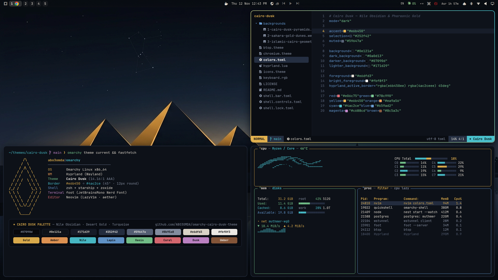

# Cairo Dusk — Omarchy Theme

**Cairo Dusk** is a high-contrast dark theme for [Omarchy](https://omarchy.org/) inspired by Cairo at twilight — pairing deep **Nile Obsidian** (`#0e121a`) surfaces with warm **Pharaonic Desert Gold** (`#e6b450`), **Sunset Terracotta** (`#ea9a56`), and **Nile Turquoise** (`#4ac2ce`) accents, and a **Warm Sandstone** (`#e6dfd3`) foreground (**14.16:1 AAA** contrast ratio).



## Installation

Install directly via the Omarchy CLI:

```bash
omarchy theme install https://github.com/ABO3OMDA/omarchy-cairo-dusk-theme
```

Or via the Omarchy menu (`Super + Space`):
1. Select **Install > Style > Theme**
2. Paste `https://github.com/ABO3OMDA/omarchy-cairo-dusk-theme`

Cycle through the 3 included 4K Cairo Dusk wallpapers anytime with:

```bash
omarchy theme bg next
```

## Optional: Rounded Corners, Obsidian Shadows & Frosted Blur

To enable the `12px` rounded corners (for both Hyprland windows and Omarchy Shell popups/menus/notifications), ambient obsidian drop shadows, and frosted blur shown in the preview, add the following to `~/.config/hypr/looknfeel.lua`:

```lua
hl.config({
  general = {
    gaps_in = 6,
    gaps_out = 12,
    border_size = 2,
  },
  decoration = {
    rounding = 12,
    dim_inactive = true,
    dim_strength = 0.08,
    shadow = {
      enabled = true,
      range = 20,
      render_power = 3,
      color = "rgba(07090ddd)",
      color_inactive = "rgba(07090d88)",
    },
    blur = {
      enabled = true,
      size = 6,
      passes = 2,
      vibrancy = 0.18,
    },
  },
})
```

## Color Palette

| Role | Name | Hex |
|------|------|-----|
| **Background** | Nile Obsidian | `#0e121a` |
| **Dark Background** | Deep Midnight | `#0a0d13` |
| **Darker Background** | Abyssal Slate | `#07090d` |
| **Lighter Background** | Elevated Basalt | `#171d29` |
| **Selection** | Twilight Indigo | `#252f42` |
| **Muted** | Desert Dusk | `#59647a` |
| **Foreground** | Warm Sandstone | `#e6dfd3` |
| **Bright Foreground** | Pure Alabaster | `#fbf8f3` |
| **Accent / Yellow** | Pharaonic Gold | `#e6b450` |
| **Orange** | Cairo Terracotta | `#ea9a56` |
| **Cyan** | Nile Turquoise | `#4ac2ce` |
| **Blue** | Lapis Lazuli | `#659ad2` |
| **Green** | Oasis Reed | `#78c990` |
| **Red** | Sinai Coral | `#e06c75` |
| **Magenta** | Dusk Bougainvillea | `#c688cd` |
| **Active Window Border** | Gold → Nile Cyan (45°) | `rgba(e6b450ee) rgba(4ac2ceee) 45deg` |

## Included 4K Wallpapers

1. `1-cairo-dusk-pyramids.webp` — Giza pyramids & Cairo skyline silhouette at twilight over the Nile
2. `2-sahara-gold-dunes.webp` — Minimalist dark Sahara dunes with molten gold rim light
3. `3-islamic-cairo-geometry.webp` — Dark obsidian & brushed gold Islamic Cairo sacred geometry

## Author

Created by [ABO3OMDA](https://github.com/ABO3OMDA). Released under the [MIT License](LICENSE).
